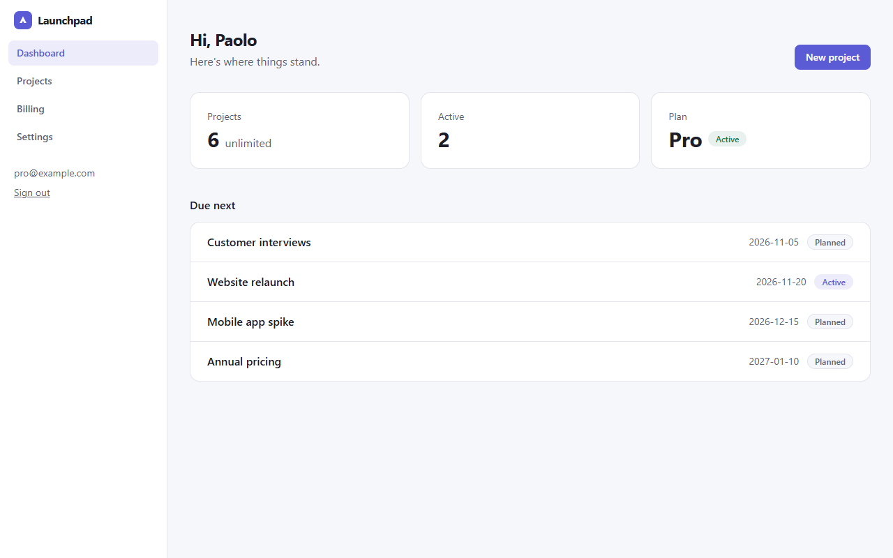

# Next.js SaaS Starter

> **Free CodePlate template, v1.2.4.** This repository mirrors the zip on [codeplate.io](https://codeplate.io/t/web-saas-starter/).
> Press **Use this template** to start your own repository from it, or [download the zip](https://codeplate.io/t/web-saas-starter/).
> [All templates](https://codeplate.io/) · [Free License](https://codeplate.io/license/free/) · subscribers get it under the [Pro License](https://codeplate.io/license/pro/) with no credit.



A working SaaS web app for **Next.js 16**, built so your AI agent can turn it into *your* product.

## What's inside

- **Accounts:** sign up, sign in, password reset by email, optional email verification, profile, change password, delete account (Better Auth, sessions in your own database).
- **A core resource:** "projects" with create, edit, delete and owner-only access. Your agent renames it to your thing: invoices, recipes, courses.
- **Plans and billing:**
  - Free / Pro / Team plans with limits enforced on the server.
  - Paddle checkout, signed webhooks that record subscriptions, and Paddle's customer portal.
  - A billing simulator, so you can try plans before you have a Paddle account.
- **Pages:** a landing page with a product illustration, features and a pricing teaser; pricing, terms and privacy stubs, dashboard, billing, settings, an admin page, error, loading and 404 pages, and a health check. A share image for link previews, a sitemap and robots.txt. Light and dark mode, phone to desktop.
- **Postgres with nothing to install:** an embedded Postgres (PGlite) for development and tests; any hosted Postgres (Neon, Supabase, your own) in production. Drizzle ORM with SQL migrations.
- **Email without an account:** in development, emails are printed and kept at `/dev/outbox`; Resend for production.
- **For your agent:**
  - a brief (`AGENTS.md`) and 11 step-by-step recipes
  - one check command: env docs, migrations, types, lint, integration tests, build and browser tests of every page and flow
  - a screenshot tool that signs in as demo users, so it can see its work

## Use it with your agent

1. Unzip this folder where you want your project to live.
2. Install [Node.js](https://nodejs.org) 22.15 or newer (24 recommended).
3. Open the folder with your agent (Claude Code or similar) and say something like:

> This is a SaaS starter template. Read AGENTS.md, then let's turn it into my product: a booking tool for yoga studios called "Flowdesk". Studios manage classes instead of projects.

The agent will ask you a few questions, record your decisions in `docs/project.md`, and change the app step by step, running the checks after each change.

## Run it yourself

```
npm install
npm run dev          # http://localhost:3000
npm run seed         # demo users: free@ / pro@ / admin@example.com, password "password123"
npm run check        # everything; ends with CODEPLATE CHECKS: PASS
```

The browser tests use Playwright's Chromium if it's installed (`npm run setup`), otherwise an installed Chrome or Edge; with neither, the first `npm run check` downloads Chromium once.

## License

You can use, modify and ship products made from this template, including commercially. Products you share must show the credit "Built with CodePlate (codeplate.io)": the template already puts it in the site footer. You can't resell the template itself. See LICENSE.md. The npm packages it installs keep their own open-source licenses: almost all MIT or Apache-2.0. Two come with Next.js itself: sharp's libvips (LGPL-3.0, for image optimization) and lightningcss (MPL-2.0, for CSS builds). Both are fine to ship in closed-source products as long as you don't modify them.

Made by [CodePlate](https://codeplate.io).
